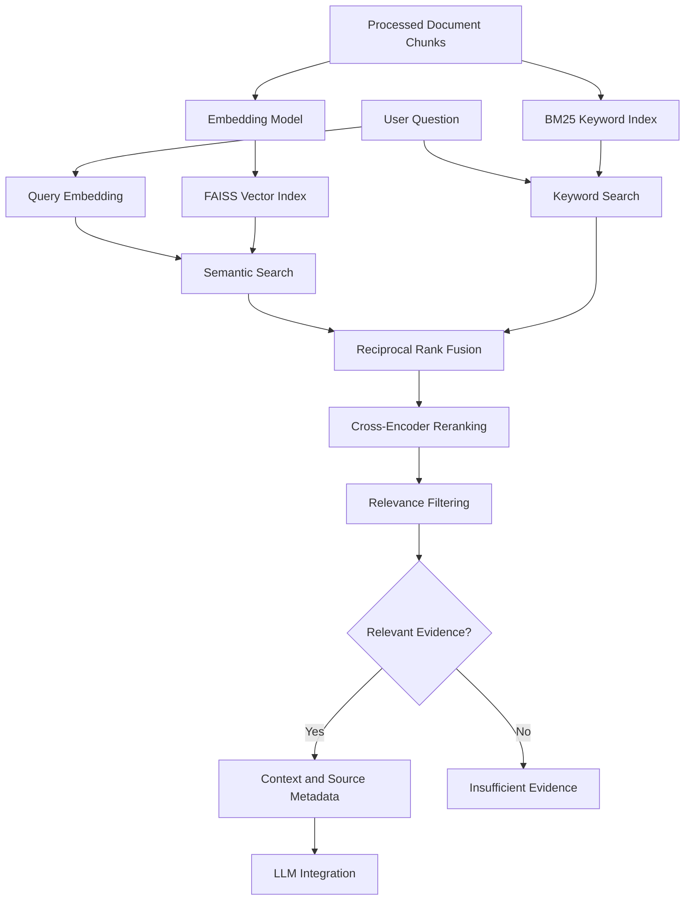

UniGuide-AI
UniGuide-AI is a Retrieval-Augmented Generation (RAG)

system designed to help Alamein International University

(AIU) students access information from official university

policy documents.

The system combines document processing, semantic search,

keyword-based retrieval, hybrid ranking, cross-encoder

reranking, and relevance filtering to provide relevant

source-grounded context for answer generation.
Project Objectives
- Provide efficient access to university policies.
- Retrieve relevant information from official documents.
- Preserve source references and document metadata.
- Reduce unsupported answers through relevance filtering.
- Support reproducible retrieval experiments and evaluation.
System Architecture
The system is organized into four main components:
1. Data Collection and Processing.
2. Embeddings and Retrieval.
3. LLM Integration and User Interface.
4. Evaluation and Performance Analysis.
The data processing and retrieval components have been

implemented. LLM integration, user interface development,

and independent final evaluation are subsequent stages.
Data Collection and Processing
The UniGuide-AI data processing pipeline prepares official Alamein International University (AIU) policy documents for a Retrieval-Augmented Generation (RAG) system supporting Arabic and English queries.
Dataset Overview
Metric	Value
Official PDF documents	26
Extracted pages	121
Extracted words	33,599
Pages enhanced with visual summaries	9
Generated chunks	202
Maximum chunk size	400 tokens
Minimum chunk size	34 tokens
Average chunk size	264.77 tokens
Target chunk overlap	60 tokens
Passed tests	27/27

Data Processing Pipeline
1. Data Collection: Collect official university policy documents from the AIU website.
2. Data Validation: Check PDF readability, duplicate files, and text availability.
3. Source Inventory: Record document metadata, source URLs, page counts, verification statuses, and review notes.
4. Text Extraction: Extract page-level text using PyMuPDF.
5. Text Cleaning: Normalize whitespace while preserving the original content and paragraph structure.
6. Image Content Processing: Supplement native text extraction with reviewed visual summaries where necessary.
7. Document Chunking: Split extracted text into overlapping, token-based chunks.
8. Metadata Preservation: Retain document identifiers, page numbers, source URLs, and review information.
9. Quality Assurance: Validate the processing pipeline through automated tests.
OCR Experiments
Basic and enhanced OCR approaches were investigated using PyMuPDF and Tesseract OCR.

The experiments included:
- Arabic and English text recognition.
- High-resolution image rendering.
- Grayscale conversion.
- Contrast enhancement and sharpening.
- OCR configuration adjustments.
Recognition errors were observed in complex forms, tables, and Arabic image-based content. Therefore, raw OCR output was not approved for ingestion.

A hybrid approach was adopted, combining native PDF text extraction with visual form summaries marked as verified in the correction inventory.

Nine pages across five documents were enhanced using this approach.
Chunking Strategy
The system implements page-aware, boundary-aware token chunking with overlapping content.
Parameter	Configuration
Tokenizer	intfloat/multilingual-e5-base
Model maximum sequence length	512 tokens
Maximum chunk size	400 tokens
Target overlap	60 tokens
Overlap percentage	15%
Page boundary preservation	Enabled
Metadata preservation	Enabled

The tokenizer is used to calculate token lengths accurately for both Arabic and English content. Natural sentence boundaries are preferred where possible, while character offsets preserve the original extracted text.

The selected chunk size leaves sufficient space for the embedding model's input prefix and special tokens.
Generated Data Files
File	Description
data/sources.csv	Source inventory and document metadata
data/ocr_corrections.json	Page-level visual summaries and review statuses
data/processed/documents.json	Extracted page-level text and metadata
data/processed/chunks.json	Processed chunks ready for embedding

Reproducing the Data Processing Pipeline
Run the following commands from the project root:
python Validate_data.py
python src/document_loader.py
python src/chunking.py
python src/update_source_inventory.py
Testing and Validation
Run the data processing tests using:
python -m pytest tests/test_document_loader.py tests/test_chunking.py -v
Test results:
Test Suite	Passed
Document Loader	11/11
Chunking	16/16
Total	27/27

The tests cover text cleaning, metadata preservation, unique identifiers, page boundaries, overlapping content, Arabic text preservation, text coverage, JSON serialization, and embedding input length.
Limitations
- OCR accuracy is affected by complex layouts, tables, and scanned Arabic forms.
- Some university policies contain outdated editions or conflicting information requiring institutional confirmation.
- Page-aware chunking may produce shorter chunks for pages with limited content.
- Retrieval effectiveness must be evaluated after embedding and indexing.
- Public accessibility of source documents does not automatically establish redistribution permission.
Embeddings and Retrieval
The retrieval component transforms processed university documents into searchable vector representations and retrieves relevant evidence for the RAG system.

It combines dense semantic retrieval, sparse keyword retrieval, reciprocal rank fusion, cross-encoder reranking, and query-level relevance filtering.
Retrieval Architecture

Retrieval Configuration
Parameter	Configuration
Embedding model	intfloat/multilingual-e5-base
Embedding dimension	768
Number of indexed chunks	202
Embedding data type	Float32
Embedding normalization	L2 normalization
Maximum embedding input length	512 tokens
Embedding batch size	16
Document prefix	passage:
Query prefix	query:
Vector search library	FAISS
Index type	IndexFlatIP
Similarity metric	Cosine similarity through normalized inner product
Keyword retrieval	BM25
BM25 k1	1.5
BM25 b	0.75
Fusion method	Reciprocal Rank Fusion
RRF constant	60
Reranking model	cross-encoder/ms-marco-MiniLM-L6-v2
Reranking batch size	8
Reranking maximum input length	512 tokens
Reranking window overlap	64 tokens
Default candidate count	20
Default final result count	5
Preliminary relevance threshold	-5.0
Default execution device	CPU

Embedding Generation
The system generates dense vector representations for the 202 processed document chunks using the Multilingual E5 Base model.

The embedding generation pipeline includes:
- Dataset validation.
- Unique chunk identifier validation.
- Model-specific document and query prefixes.
- Token-length validation before encoding.
- Batch-based embedding generation.
- L2 normalization.
- Embedding dimension and numerical validity checks.
- Metadata preservation.
- Local embedding storage.
The resulting embedding matrix has a shape of (202, 768).
Vector Storage and Semantic Search
FAISS is used to implement exact similarity search over normalized document embeddings.

The IndexFlatIP index performs inner-product search, which is equivalent to cosine similarity when both document and query vectors are L2-normalized.

The vector storage component validates embedding dimensions, vector counts, metadata alignment, numerical values, and normalization.

An index manifest containing file hashes is maintained to detect changes to stored embeddings, metadata, configuration, and index files.
BM25 Keyword Retrieval
BM25 complements semantic retrieval by identifying documents containing relevant query terms.

The implementation includes:
- Case normalization.
- Punctuation handling.
- English stop-word removal.
- Domain-specific term normalization.
- Term-frequency and inverse-document-frequency scoring.
- Document-length normalization.
- Positive-score filtering.
Important academic terms such as GPA and CGPA are preserved as distinct terms.
Hybrid Retrieval
Semantic and keyword retrieval results are combined using Reciprocal Rank Fusion (RRF).

RRF combines rankings rather than directly combining incompatible cosine similarity and BM25 scores.

The fusion component removes duplicate chunk identifiers while preserving original retrieval scores, ranks, and source metadata.
Cross-Encoder Reranking
The system uses cross-encoder/ms-marco-MiniLM-L6-v2 to rerank candidates obtained through hybrid retrieval.

The default configuration retrieves 20 hybrid candidates and returns the five highest-ranked results.

Query-passage pairs are evaluated jointly to improve relevance ranking.

For passages exceeding the model's available token budget, overlapping token windows are generated. Each window is scored independently, and the maximum window score is used as the passage score.

This approach avoids deliberate truncation of oversized passages while preserving the original document text.
Relevance Filtering
A preliminary query-level relevance threshold of -5.0 is applied to the maximum cross-encoder score.

If the maximum score meets or exceeds the threshold, the retrieved results are retained for context construction. Otherwise, the system returns an insufficient-relevance decision with an empty context.

The threshold is provisional and requires independent evaluation.

Passing the relevance threshold does not guarantee that the retrieved evidence fully answers the question. The LLM component must also assess evidence sufficiency before generating an answer.
Retrieval Modes
Mode	Description
semantic	Dense vector similarity search
keyword	BM25 keyword retrieval
hybrid	Semantic and keyword retrieval combined through RRF
reranked	Hybrid retrieval followed by cross-encoder reranking

The default mode of the general retrieval interface is hybrid.

For LLM integration, the relevance-aware retrieval interface is recommended.
Retrieval API
Basic retrieval:
from src.retrieval import RetrievalEngine
engine = RetrievalEngine()
results = engine.retrieve(
    query="How can I register for courses?",
    top_k=5,
    mode="reranked"
)
for result in results:
    print(result["document_title"])
    print(result["chunk_id"])
    print(result["text"])
Relevance-aware retrieval:
from src.retrieval import RetrievalEngine
engine = RetrievalEngine()
response = engine.retrieve_with_relevance(
    query="How can I withdraw from a course?",
    top_k=5,
    candidate_k=20,
    threshold=-5.0
)
if response["relevance_passed"]:
    context = response["context"]
    sources = response["results"]
else:
    print("Insufficient relevant information.")
The relevance-aware interface returns the following fields:
Field	Description
query	Normalized user question
retrieval_mode	Retrieval strategy used
relevance_passed	Query-level relevance decision
max_score	Maximum cross-encoder score
threshold	Applied relevance threshold
reason	Explanation of the relevance decision
retrieved_count	Number of initially retrieved results
retained_count	Number of results retained after filtering
results	Retrieved chunks and source metadata
context	Formatted evidence for LLM integration

The retrieval engine should be initialized once and reused across multiple queries where possible.
Comparative Embedding Experiments
Three embedding models were investigated using the same dataset of 202 document chunks.
Model	Dimension	Hit@1	Hit@5	MRR@10
Multilingual E5 Base	768	25.0%	87.5%	0.4792
English E5 Base v2	768	50.0%	87.5%	0.6292
BGE Base English v1.5	768	50.0%	87.5%	0.5875

The preliminary comparison used eight development questions with one tracked target chunk per question.

English E5 Base v2 achieved the highest preliminary MRR@10. However, Multilingual E5 Base was retained provisionally because of its multilingual capabilities, tokenizer coverage, and existing integration with the production retrieval pipeline.

The tokenizer audit identified no oversized embedding inputs or unknown tokens for Multilingual E5 on the current dataset. The English E5 and BGE models required window-based encoding for two oversized chunks.

The comparative retrieval evaluation was reproduced using the saved embeddings, with all 24 tracked target rankings matching the original experiment.

Final model selection is subject to independent evaluation.
Preliminary Retrieval Performance
Four retrieval modes were compared using three answerable development questions with tracked target chunks.
Retrieval mode	MRR@5
Semantic	0.3611
BM25	0.5000
Hybrid	0.4833
Hybrid with reranking	0.8333

Cross-encoder reranking achieved a relative MRR@5 improvement of approximately 72.4% over hybrid retrieval on this small development sample.

These results are preliminary and should not be interpreted as final system-wide retrieval accuracy.
Preliminary Relevance Evaluation
The relevance threshold was investigated using 20 development questions, including ten answerable and ten out-of-scope questions.
Metric	Result
True positives	10
True negatives	8
False positives	2
False negatives	0
Accuracy	90.00%
Precision	83.33%
Recall	100.00%
F1-score	90.91%

These metrics describe preliminary query-level relevance classification, not final answer correctness or document-level retrieval performance.
Retrieval Component Files
File	Responsibility
src/embeddings.py	Document and query embedding generation
src/vector_store.py	FAISS indexing, validation, and similarity search
src/keyword_search.py	BM25 keyword retrieval
src/rank_fusion.py	Reciprocal Rank Fusion
src/reranker.py	Cross-encoder reranking and token-window handling
src/relevance_filter.py	Query-level relevance filtering
src/retrieval.py	Integrated retrieval engine and context construction
evaluation/semantic_search_demo.py	Semantic retrieval demonstration
evaluation/generate_comparative_embeddings.py	Comparative embedding generation
evaluation/evaluate_embedding_models.py	Comparative retrieval evaluation
evaluation/experiments/	Experiment metadata, results, and documentation

Precomputed Embeddings and Vector Index
The repository includes precomputed embeddings and a FAISS vector index for the current dataset of 202 chunks, using the intfloat/multilingual-e5-base model with 768-dimensional embeddings.
File	Description
data/embeddings/embeddings.npy	Normalized document embedding matrix
data/embeddings/metadata.json	Chunk text and source metadata
data/embeddings/config.json	Embedding configuration
data/embeddings/index.faiss	FAISS vector index
data/embeddings/index_manifest.json	Index integrity metadata

Team members can use these artifacts directly without regenerating the embeddings. Regeneration is required when the dataset, embedding model, or relevant embedding configuration changes.

Pretrained model weights, cache files, comparative embedding arrays, and sensitive credentials remain excluded from version control.
Installation and Reproduction
Python 3.12 was used during development.
1. Install Dependencies
Run the following commands from the project root:
python -m pip install -r requirements.txt
python -m pip check
A CPU-compatible PyTorch installation is recommended for systems without a supported GPU.
2. Run the Retrieval Pipeline
The repository includes precomputed production embeddings and a FAISS vector index. No initial embedding regeneration is required.
python -m src.retrieval
The first execution may require an internet connection to download the pretrained embedding model and cross-encoder reranker.
3. Regenerate Retrieval Artifacts (When Needed)
Regenerate the artifacts if the dataset, embedding model, or relevant embedding configuration changes.

Ensure that data/processed/chunks.json exists, then run:
python -m src.embeddings
python -m src.vector_store
Verify the regenerated artifacts:
python -m src.retrieval
Reproducing Comparative Experiments
Generate comparative embeddings:
python -m evaluation.generate_comparative_embeddings
Evaluate the generated embeddings:
python -m evaluation.evaluate_embedding_models
Additional command-line options are available through:
python -m evaluation.generate_comparative_embeddings --help
python -m evaluation.evaluate_embedding_models --help
See [Comparative Experiment Documentation](evaluation/experiments/README.md) for experimental configurations, saved results, reproduction details, and limitations.

The comparative generation script has passed syntax and command-line validation. Full regeneration using the saved script has not yet been independently verified.
Testing and Validation
Run the complete automated test suite:
python -m pytest tests -v --tb=short
Test suite	Passed
Document Loader	11/11
Chunking	16/16
Embeddings	20/20
Vector Store	23/23
Keyword Search	38/38
Rank Fusion	24/24
Reranker	35/35
Relevance Filter	35/35
Retrieval	52/52
Total	254/254

Following dependency resolution, all 254 automated tests passed with zero failures and five SWIG-related deprecation warnings.

The real-model integration test also completed successfully across four questions and four retrieval modes.

The development environment reported no broken package requirements when checked using:
python -m pip check
These results validate the tested data processing and retrieval components. They do not establish final LLM or user interface correctness.
Known Limitations
- The embedding comparison uses only eight development questions.
- The retrieval-mode comparison uses only three answerable development questions.
- Single-target evaluation does not capture every potentially relevant document chunk.
- The selected embedding model and relevance threshold remain provisional.
- BM25 normalization is primarily designed for English queries.
- The cross-encoder is primarily trained for English retrieval tasks.
- Maximum-window score aggregation may favor longer passages.
- Query-level relevance filtering does not guarantee complete answerability.
- Overlapping document chunks may introduce redundant context.
- Retrieval latency depends on hardware and runtime conditions.
- Pretrained model revisions are not explicitly pinned.
- Installation in a clean environment has not yet been independently verified.
- Streamlit runtime validation and full LLM integration are not established by the retrieval tests.
Future Integration and Evaluation
The next development stages include:
- LLM integration using relevance-aware retrieval.
- Source-grounded answer generation and citations.
- Streamlit user interface development.
- Independent evaluation using a larger annotated question set.
- Comparison of embedding models and retrieval strategies.
- Relevance threshold refinement.
- Final answer-quality and performance evaluation.