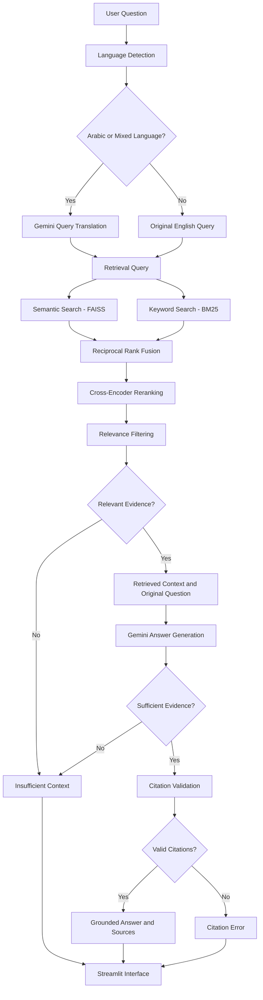

# UniGuide-AI

**A Bilingual Retrieval-Augmented Generation (RAG) University Assistant**

UniGuide-AI is an AI-powered chatbot designed to help Alamein International University (AIU) students access official university policies and academic regulations through natural-language questions in Arabic and English.

The system combines document processing, multilingual embeddings, semantic and keyword retrieval, cross-encoder reranking, automatic query translation, and Google Gemini to generate source-grounded answers with validated citations.

## Live Demo

**Application:** [UniGuide-AI](https://uniguide-ai.streamlit.app/)

| Project Metric | Value |
|---|---:|
| Official university documents | 26 |
| Processed pages | 121 |
| Indexed knowledge chunks | 202 |
| Embedding dimensions | 768 |
| Supported languages | Arabic and English |
| Evaluation questions | 70 |
| Held-out test questions | 42 |
| Automated tests passed | 573/573 |
| Online functional acceptance checks | 10/10 |
| Deployment platform | Streamlit Community Cloud |

**Project Status:** Core implementation, cloud deployment, comparative evaluation, and automated regression testing completed.

## Application Demo

Watch UniGuide-AI in action, showcasing bilingual question
answering, source-grounded responses, and an interactive
university assistant interface.

https://github.com/user-attachments/assets/9d3819a4-414b-4d7d-a3be-5e1c51cc9f65

## 1. Problem Statement

University students often struggle to locate accurate information across multiple policy documents, academic regulations, and administrative procedures.

Traditional document searching is time-consuming, while standalone large language models may generate inaccurate or unsupported university-specific information.

UniGuide-AI addresses this problem by retrieving relevant evidence from official university documents before generating answers.

## 2. Project Objectives

- Provide efficient access to university policies and academic regulations.
- Support Arabic and English natural-language questions.
- Retrieve relevant evidence using semantic and keyword search.
- Improve retrieval quality through hybrid ranking and cross-encoder reranking.
- Generate accurate, relevant, and source-grounded answers.
- Reduce unsupported responses through relevance filtering and citation validation.
- Provide an accessible web-based chatbot.
- Evaluate the effectiveness of RAG compared with standalone LLM generation.

## 3. System Architecture

Translation failures and API errors are handled separately by the RAG pipeline.

## 4. Technology Stack

| Component | Technology |
|---|---|
| Programming language | Python 3.12 |
| PDF processing | PyMuPDF |
| OCR experiments | Tesseract OCR |
| Embedding framework | Sentence Transformers |
| Embedding model | intfloat/multilingual-e5-base |
| Numerical computation | NumPy |
| Vector search | FAISS |
| Keyword retrieval | BM25 |
| Rank fusion | Reciprocal Rank Fusion |
| Reranking | Cross-Encoder |
| Large language model | Google Gemini 3.1 Flash-Lite |
| User interface | Streamlit |
| Testing | Pytest |
| Visualization | Matplotlib |
| Version control | Git and GitHub |
| Deployment | Streamlit Community Cloud |

## 5. Data Collection and Preprocessing

The knowledge base consists of 26 official AIU policy documents covering academic regulations, registration, attendance, examinations, tuition fees, withdrawal, student services, and other university-related topics.

### Dataset Statistics

| Metric | Value |
|---|---:|
| PDF documents | 26 |
| Extracted pages | 121 |
| Extracted words | 33,599 |
| Pages enhanced with visual summaries | 9 |
| Generated chunks | 202 |
| Maximum chunk size | 400 tokens |
| Minimum chunk size | 34 tokens |
| Average chunk size | 264.77 tokens |
| Target chunk overlap | 60 tokens |

### Processing Pipeline

1. Collect official university policy documents.
2. Validate PDF readability and document metadata.
3. Extract page-level text using PyMuPDF.
4. Clean and normalize extracted content.
5. Investigate OCR for scanned forms and image-based content.
6. Supplement native extraction with reviewed visual summaries where necessary.
7. Generate overlapping, page-aware token chunks.
8. Preserve source URLs, document identifiers, page numbers, and review metadata.
9. Validate the generated data through automated tests.

Raw OCR output was not approved for ingestion because of recognition errors in complex forms, tables, and Arabic image-based content.

### Generated Data Files

| File | Description |
|---|---|
| `data/sources.csv` | Source inventory and metadata |
| `data/ocr_corrections.json` | Reviewed visual summaries |
| `data/processed/documents.json` | Extracted document text |
| `data/processed/chunks.json` | Processed knowledge chunks |

## 6. Embeddings and Retrieval

### Embedding Configuration

The system uses Multilingual E5 Base to generate normalized, 768-dimensional vector representations.

| Parameter | Configuration |
|---|---|
| Embedding model | intfloat/multilingual-e5-base |
| Embedding matrix | 202 × 768 |
| Data type | Float32 |
| Normalization | L2 |
| Maximum input length | 512 tokens |
| Document prefix | `passage:` |
| Query prefix | `query:` |
| Embedding batch size | 16 |

### Retrieval Strategies

The system implements four retrieval modes:

| Mode | Description |
|---|---|
| Semantic | Dense vector similarity search |
| Keyword | BM25 keyword retrieval |
| Hybrid | Semantic and keyword retrieval combined using RRF |
| Reranked | Hybrid retrieval followed by cross-encoder reranking |

Semantic retrieval uses multilingual E5 embeddings and NumPy-based cosine similarity with Top-K ranking. FAISS is retained for efficient vector storage and reconstruction.

The NumPy implementation was verified against FAISS across 544 retrieval comparisons, achieving 100% chunk selection equivalence and 96.14% exact ranking equivalence.

See [NumPy Verification](evaluation/NUMPY_VERIFICATION.md) for detailed results and limitations.

### Retrieval Configuration

| Parameter | Value |
|---|---|
| Vector index | FAISS IndexFlatIP |
| BM25 k1 | 1.5 |
| BM25 b | 0.75 |
| RRF constant | 60 |
| Reranking model | cross-encoder/ms-marco-MiniLM-L6-v2 |
| Candidate count | 20 |
| Final retrieved chunks | 5 |
| Application default relevance threshold | -5.0 |
| Final evaluation relevance threshold | -8.0 |
| Execution device | CPU |

The relevance filter evaluates the maximum cross-encoder score at the query level. Passing the threshold does not guarantee that the retrieved evidence is sufficient to answer the question.

### Precomputed Retrieval Artifacts

The repository includes:

- `data/embeddings/embeddings.npy`
- `data/embeddings/metadata.json`
- `data/embeddings/config.json`
- `data/embeddings/index.faiss`
- `data/embeddings/index_manifest.json`

These artifacts allow the application to run without regenerating document embeddings.

## 7. LLM Integration and User Interface

### LLM Configuration

| Parameter | Configuration |
|---|---|
| Provider | Google Gemini |
| Default model | gemini-3.1-flash-lite |
| Alternative evaluated model | gemini-3.5-flash-lite |
| Request timeout | 120,000 ms |
| Maximum attempts | 3 |
| Retryable API error | HTTP 503 |
| Retry delays | 10 and 20 seconds |

The generation prompt instructs the LLM to answer using retrieved evidence, preserve important conditions and exceptions, respond in the original question language, provide supporting citations, and abstain when evidence is insufficient.

### Automatic Query Translation

Arabic and mixed-language questions are translated into English before retrieval to improve compatibility with the English-oriented BM25 and reranking components.

The original question is preserved for answer generation, allowing the chatbot to respond in the user's language.

### Citation Validation

Generated answers contain supporting chunk identifiers, such as:

`[AIU-003-P002-C002]`

The citation validator checks whether identifiers are correctly formatted and belong to the retrieved evidence.

Identifier validation does not guarantee complete semantic support for every generated claim.

### Chatbot Features

- Arabic and English question input.
- Source-grounded answers.
- Expandable citations and original document links.
- Suggested university-related questions.
- Response-time display.
- Insufficient-context and error handling.
- Session-based conversation history.
- Independent browser sessions.
- Responsive desktop and mobile layouts.

The application uses shared retrieval resources through Streamlit caching to reduce redundant model loading.

Conversation history is displayed but is not automatically included in subsequent retrieval and generation requests.

## 8. Evaluation and Performance Analysis

> **Evaluation Note:** The original RAG evaluation was conducted
> using FAISS-based similarity search. The subsequent NumPy
> implementation was validated through semantic retrieval
> equivalence checks and full regression testing.
> The original evaluation results remain unchanged.
> See [NumPy Verification](evaluation/NUMPY_VERIFICATION.md)
> for detailed results and limitations.

### 8.1 Evaluation Dataset

A bilingual annotated evaluation dataset was prepared and frozen as version 1.0.0.

| Metric | Development Set | Test Set | Total |
|---|---:|---:|---:|
| Questions | 28 | 42 | 70 |
| English | 20 | 30 | 50 |
| Arabic | 8 | 12 | 20 |
| Answerable | 25 | 38 | 63 |
| Unanswerable | 3 | 4 | 7 |

The dataset includes direct factual, paraphrased, procedural, complex reasoning, and unanswerable questions.

Each question includes a reference answer, relevant chunk identifiers, source documents, language, category, difficulty, answerability, and review status.

The development set was used for configuration selection. The held-out test set was used for final end-to-end evaluation.

### 8.2 Embedding Model Comparison

Three embedding models were evaluated using the same knowledge base and development questions.

**Before query translation:**

| Model | Hit@5 | Recall@5 | MRR@10 | nDCG@10 |
|---|---:|---:|---:|---:|
| Multilingual E5 Base | 72% | 70% | 0.6237 | 0.6683 |
| English E5 Base v2 | 72% | 70% | 0.5667 | 0.5908 |
| BGE Base English v1.5 | 64% | 62% | 0.5533 | 0.5837 |

**After translating Arabic queries:**

| Model | Overall Recall@5 |
|---|---:|
| Multilingual E5 Base | 93% |
| English E5 Base v2 | 97% |
| BGE Base English v1.5 | 89% |

Multilingual E5 Base was retained as an engineering trade-off because of its multilingual capabilities, ranking performance, tokenizer compatibility, and existing system integration.

English E5 achieved higher overall Recall@5 after translation, so the selected model should not be interpreted as universally superior.

### 8.3 Arabic Query Translation Evaluation

The translation experiment evaluated seven answerable Arabic development questions.

| Model | Before Translation Recall@5 | After Translation Recall@5 |
|---|---:|---:|
| Multilingual E5 Base | 14.29% | 96.43% |
| English E5 Base v2 | 0.00% | 96.43% |
| BGE Base English v1.5 | 0.00% | 96.43% |

For Multilingual E5 Base, translation improved Arabic Recall@5 by 82.14 percentage points on the evaluated sample.

### 8.4 Retrieval Strategy Comparison

Four retrieval strategies were evaluated using the development set. Ranking metrics were calculated over the 25 answerable questions.

| Strategy | Hit@5 | Recall@5 | MRR@5 | nDCG@5 | Mean Latency |
|---|---:|---:|---:|---:|---:|
| Semantic | 96% | 93% | 0.8333 | 0.8394 | 69.06 ms |
| Keyword | 96% | 95% | 0.8467 | 0.8626 | 0.88 ms |
| Hybrid | 100% | 99% | 0.9133 | 0.9177 | 68.28 ms |
| Reranked | 100% | 99% | 0.9267 | 0.9325 | 1545.31 ms |

Hybrid retrieval improved evidence recall compared with individual retrieval methods.

Cross-encoder reranking achieved the highest overall MRR@5 and nDCG@5, although it introduced additional computational latency.

Hybrid retrieval remains a viable alternative when response speed is prioritized.

### 8.5 Relevance Threshold Selection

A threshold sweep was conducted using the 28 development questions.

| Metric | Threshold -5.0 | Threshold -8.0 |
|---|---:|---:|
| Accuracy | 92.86% | 92.86% |
| Precision | 96.00% | 92.59% |
| Recall | 96.00% | 100.00% |
| F1-score | 96.00% | 96.15% |
| Specificity | 66.67% | 33.33% |
| False negatives | 1 | 0 |
| False positives | 1 | 2 |

The threshold of -8.0 was selected for the final evaluation using a recall-first strategy to reduce premature rejection of answerable questions.

This selection increases the risk of retaining irrelevant evidence. The LLM must therefore assess context sufficiency before answering.

The deployed application retains its original default threshold of -5.0. Final evaluation results correspond to the explicitly evaluated configuration of -8.0.

### 8.6 LLM Model Selection

Two Gemini models were compared using 12 development questions with fixed retrieved contexts.

| Metric | Gemini 3.5 Flash-Lite | Gemini 3.1 Flash-Lite |
|---|---:|---:|
| Weighted evaluation score | 83.54% | 95.83% |
| Mean successful response latency | 3.30 s | 14.17 s |
| Valid citation identifiers | 22/22 | 30/30 |
| Correct abstentions | 2/2 | 2/2 |
| False abstentions |