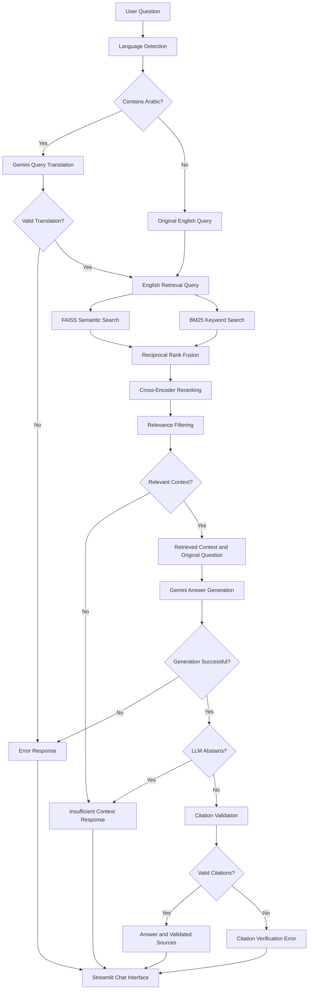
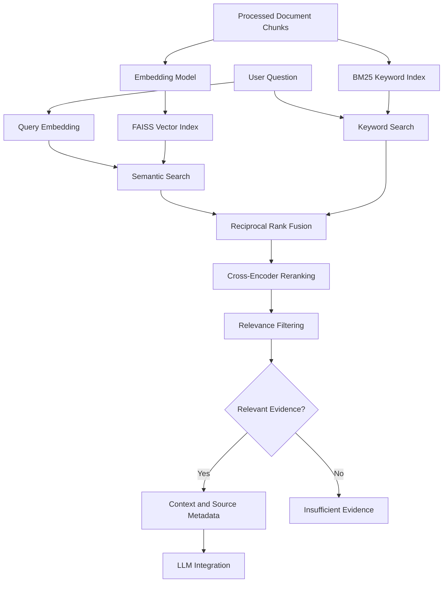

# UniGuide-AI

**A Bilingual Retrieval-Augmented Generation (RAG) University Assistant**

UniGuide-AI is an AI-powered university assistant designed to help Alamein International University (AIU) students access information from official university policy documents through natural-language questions in Arabic and English.

The system integrates document processing, multilingual embeddings, FAISS vector search, BM25 keyword retrieval, hybrid ranking, cross-encoder reranking, automatic query translation, and Google Gemini to generate source-grounded answers with validated citations.

The application provides an interactive Streamlit chatbot accessible from desktop and mobile devices.

## Live Demo

**Application:** [UniGuide-AI](https://uniguide-ai.streamlit.app/)

| Project Metric | Value |
|---|---:|
| Official university documents | 26 |
| Processed pages | 121 |
| Indexed knowledge chunks | 202 |
| Embedding dimensions | 768 |
| Supported languages | Arabic and English |
| Automated tests passed | 555/555 |
| Online functional acceptance checks | 10/10 |
| Deployment platform | Streamlit Community Cloud |

**Project Status:** Core implementation and cloud deployment completed. Independent comprehensive evaluation is pending.

> UniGuide-AI is an academic project and is not an official university service. Important academic decisions should always be verified against official university documents.

## Project Objectives

- Provide efficient access to official university policies and academic regulations.
- Support natural-language questions in Arabic and English.
- Retrieve relevant evidence using semantic search, keyword retrieval, and hybrid ranking.
- Improve retrieval relevance through cross-encoder reranking.
- Generate source-grounded answers using a pretrained large language model.
- Reduce unsupported responses through relevance filtering, evidence-aware generation, and citation validation.
- Preserve document metadata and provide access to original university sources.
- Provide an accessible, responsive web-based chatbot.
- Support reproducible experiments and systematic performance evaluation.

## System Architecture

The system is organized into four main components:

1. Data Collection and Processing.
2. Embeddings and Retrieval.
3. LLM Integration and User Interface.
4. Evaluation and Performance Analysis.

The data processing, embeddings, retrieval, LLM integration, and Streamlit user interface components have been implemented and tested.

The system supports English and Arabic questions, automatic query translation, relevance-aware retrieval, source-grounded answer generation, citation validation, and session-based conversation management.

Independent final evaluation and comparative performance analysis remain the next development stage.

### End-to-End RAG Architecture



## Data Collection and Processing

The UniGuide-AI data processing pipeline prepares official Alamein International University (AIU) policy documents for a Retrieval-Augmented Generation (RAG) system supporting Arabic and English queries.

### Dataset Overview

| Metric | Value |
|---|---|
| Official PDF documents | 26 |
| Extracted pages | 121 |
| Extracted words | 33,599 |
| Pages enhanced with visual summaries | 9 |
| Generated chunks | 202 |
| Maximum chunk size | 400 tokens |
| Minimum chunk size | 34 tokens |
| Average chunk size | 264.77 tokens |
| Target chunk overlap | 60 tokens |
| Passed tests | 27/27 |

### Data Processing Pipeline

1. Data Collection: Collect official university policy documents from the AIU website.
2. Data Validation: Check PDF readability, duplicate files, and text availability.
3. Source Inventory: Record document metadata, source URLs, page counts, verification statuses, and review notes.
4. Text Extraction: Extract page-level text using PyMuPDF.
5. Text Cleaning: Normalize whitespace while preserving the original content and paragraph structure.
6. Image Content Processing: Supplement native text extraction with reviewed visual summaries where necessary.
7. Document Chunking: Split extracted text into overlapping, token-based chunks.
8. Metadata Preservation: Retain document identifiers, page numbers, source URLs, and review information.
9. Quality Assurance: Validate the processing pipeline through automated tests.

### OCR Experiments

Basic and enhanced OCR approaches were investigated using PyMuPDF and Tesseract OCR.

The experiments included:

- Arabic and English text recognition.
- High-resolution image rendering.
- Grayscale conversion.
- Contrast enhancement and sharpening.
- OCR configuration adjustments.

Recognition errors were observed in complex forms, tables, and Arabic image-based content. Therefore, raw OCR output was not approved for ingestion.

A hybrid approach was adopted, combining native PDF text extraction with visual form summaries marked as verified in the correction inventory.

Nine pages across five documents were enhanced using this approach.

### Chunking Strategy

The system implements page-aware, boundary-aware token chunking with overlapping content.

| Parameter | Configuration |
|---|---|
| Tokenizer | intfloat/multilingual-e5-base |
| Model maximum sequence length | 512 tokens |
| Maximum chunk size | 400 tokens |
| Target overlap | 60 tokens |
| Overlap percentage | 15% |
| Page boundary preservation | Enabled |
| Metadata preservation | Enabled |

The tokenizer is used to calculate token lengths accurately for both Arabic and English content. Natural sentence boundaries are preferred where possible, while character offsets preserve the original extracted text.

The selected chunk size leaves sufficient space for the embedding model's input prefix and special tokens.

### Generated Data Files

| File | Description |
|---|---|
| data/sources.csv | Source inventory and document metadata |
| data/ocr_corrections.json | Page-level visual summaries and review statuses |
| data/processed/documents.json | Extracted page-level text and metadata |
| data/processed/chunks.json | Processed chunks ready for embedding |

### Reproducing the Data Processing Pipeline

Run the following commands from the project root:

```bash
python Validate_data.py
python src/document_loader.py
python src/chunking.py
python src/update_source_inventory.py
```

### Data Processing Testing and Validation

Run the data processing tests using:

```bash
python -m pytest tests/test_document_loader.py tests/test_chunking.py -v
```

Test results:

| Test Suite | Passed |
|---|---|
| Document Loader | 11/11 |
| Chunking | 16/16 |
| Total | 27/27 |

The tests cover text cleaning, metadata preservation, unique identifiers, page boundaries, overlapping content, Arabic text preservation, text coverage, JSON serialization, and embedding input length.

### Data Processing Limitations

- OCR accuracy is affected by complex layouts, tables, and scanned Arabic forms.
- Some university policies contain outdated editions or conflicting information requiring institutional confirmation.
- Page-aware chunking may produce shorter chunks for pages with limited content.
- Retrieval effectiveness must be evaluated after embedding and indexing.
- Public accessibility of source documents does not automatically establish redistribution permission.

## Embeddings and Retrieval

The retrieval component transforms processed university documents into searchable vector representations and retrieves relevant evidence for the RAG system.

It combines dense semantic retrieval, sparse keyword retrieval, reciprocal rank fusion, cross-encoder reranking, and query-level relevance filtering.

### Retrieval Architecture


Retrieval Configuration

| Parameter | Configuration |
|---|---|
| Embedding model | intfloat/multilingual-e5-base |
| Embedding dimension | 768 |
| Number of indexed chunks | 202 |
| Embedding data type | Float32 |
| Embedding normalization | L2 normalization |
| Maximum embedding input length | 512 tokens |
| Embedding batch size | 16 |
| Document prefix | passage: |
| Query prefix | query: |
| Vector search library | FAISS |
| Index type | IndexFlatIP |
| Similarity metric | Cosine similarity through normalized inner product |
| Keyword retrieval | BM25 |
| BM25 k1 | 1.5 |
| BM25 b | 0.75 |
| Fusion method | Reciprocal Rank Fusion |
| RRF constant | 60 |
| Reranking model | cross-encoder/ms-marco-MiniLM-L6-v2 |
| Reranking batch size | 8 |
| Reranking maximum input length | 512 tokens |
| Reranking window overlap | 64 tokens |
| Default candidate count | 20 |
| Default final result count | 5 |
| Preliminary relevance threshold | -5.0 |
| Default execution device | CPU |

### Embedding Generation

The system generates dense vector representations for the 202 processed document chunks using the Multilingual E5 Base model.

The embedding generation pipeline includes:

- Dataset validation.
- Unique chunk identifier validation.
- Model-specific document and query prefixes.
- Token-length validation before encoding.
- Batch-based embedding generation.
- L2 normalization.
- Embedding dimension and numerical validity checks.
- Metadata preservation.
- Local embedding storage.

The resulting embedding matrix has a shape of (202, 768).

### Vector Storage and Semantic Search

FAISS is used to implement exact similarity search over normalized document embeddings.

The IndexFlatIP index performs inner-product search, which is equivalent to cosine similarity when both document and query vectors are L2-normalized.

The vector storage component validates embedding dimensions, vector counts, metadata alignment, numerical values, and normalization.

An index manifest containing file hashes is maintained to detect changes to stored embeddings, metadata, configuration, and index files.

### BM25 Keyword Retrieval

BM25 complements semantic retrieval by identifying documents containing relevant query terms.

The implementation includes:

- Case normalization.
- Punctuation handling.
- English stop-word removal.
- Domain-specific term normalization.
- Term-frequency and inverse-document-frequency scoring.
- Document-length normalization.
- Positive-score filtering.

Important academic terms such as GPA and CGPA are preserved as distinct terms.

### Hybrid Retrieval

Semantic and keyword retrieval results are combined using Reciprocal Rank Fusion (RRF).

RRF combines rankings rather than directly combining incompatible cosine similarity and BM25 scores.

The fusion component removes duplicate chunk identifiers while preserving original retrieval scores, ranks, and source metadata.

### Cross-Encoder Reranking

The system uses cross-encoder/ms-marco-MiniLM-L6-v2 to rerank candidates obtained through hybrid retrieval.

The default configuration retrieves 20 hybrid candidates and returns the five highest-ranked results.

Query-passage pairs are evaluated jointly to improve relevance ranking.

For passages exceeding the model's available token budget, overlapping token windows are generated. Each window is scored independently, and the maximum window score is used as the passage score.

This approach avoids deliberate truncation of oversized passages while preserving the original document text.

### Relevance Filtering

A preliminary query-level relevance threshold of -5.0 is applied to the maximum cross-encoder score.

If the maximum score meets or exceeds the threshold, the retrieved results are retained for context construction. Otherwise, the system returns an insufficient-relevance decision with an empty context.

The threshold is provisional and requires independent evaluation.

Passing the relevance threshold does not guarantee that the retrieved evidence fully answers the question. The LLM component must also assess evidence sufficiency before generating an answer.

### Retrieval Modes

| Mode | Description |
|---|---|
| semantic | Dense vector similarity search |
| keyword | BM25 keyword retrieval |
| hybrid | Semantic and keyword retrieval combined through RRF |
| reranked | Hybrid retrieval followed by cross-encoder reranking |

The default mode of the general retrieval interface is hybrid.

For LLM integration, the relevance-aware retrieval interface is recommended.

### Retrieval API

Basic retrieval:

```python
from src.retrieval import RetrievalEngine
engine = RetrievalEngine()
results = engine.retrieve(
    query="How can I register for courses?",
    top_k=5,
    mode="reranked"
)
for result in results:
    print(result["document_title"])
    print(result["chunk_id"])
    print(result["text"])
```

Relevance-aware retrieval:

```python
from src.retrieval import RetrievalEngine
engine = RetrievalEngine()
response = engine.retrieve_with_relevance(
    query="How can I withdraw from a course?",
    top_k=5,
    candidate_k=20,
    threshold=-5.0
)
if response["relevance_passed"]:
    context = response["context"]
    sources = response["results"]
else:
    print("Insufficient relevant information.")
```

The relevance-aware interface returns the following fields:

| Field | Description |
|---|---|
| query | Normalized user question |
| retrieval_mode | Retrieval strategy used |
| relevance_passed | Query-level relevance decision |
| max_score | Maximum cross-encoder score |
| threshold | Applied relevance threshold |
| reason | Explanation of the relevance decision |
| retrieved_count | Number of initially retrieved results |
| retained_count | Number of results retained after filtering |
| results | Retrieved chunks and source metadata |
| context | Formatted evidence for LLM integration |

The retrieval engine should be initialized once and reused across multiple queries where possible.

### Comparative Embedding Experiments

Three embedding models were investigated using the same dataset of 202 document chunks.

| Model | Dimension | Hit@1 | Hit@5 | MRR@10 |
|---|---|---|---|---|
| Multilingual E5 Base | 768 | 25.0% | 87.5% | 0.4792 |
| English E5 Base v2 | 768 | 50.0% | 87.5% | 0.6292 |
| BGE Base English v1.5 | 768 | 50.0% | 87.5% | 0.5875 |

The preliminary comparison used eight development questions with one tracked target chunk per question.

English E5 Base v2 achieved the highest preliminary MRR@10. However, Multilingual E5 Base was retained provisionally because of its multilingual capabilities, tokenizer coverage, and existing integration with the production retrieval pipeline.

The tokenizer audit identified no oversized embedding inputs or unknown tokens for Multilingual E5 on the current dataset. The English E5 and BGE models required window-based encoding for two oversized chunks.

The comparative retrieval evaluation was reproduced using the saved embeddings, with all 24 tracked target rankings matching the original experiment.

Final model selection is subject to independent evaluation.

### Preliminary Retrieval Performance

Four retrieval modes were compared using three answerable development questions with tracked target chunks.

| Retrieval mode | MRR@5 |
|---|---|
| Semantic | 0.3611 |
| BM25 | 0.5000 |
| Hybrid | 0.4833 |
| Hybrid with reranking | 0.8333 |

Cross-encoder reranking achieved a relative MRR@5 improvement of approximately 72.4% over hybrid retrieval on this small development sample.

These results are preliminary and should not be interpreted as final system-wide retrieval accuracy.

### Preliminary Relevance Evaluation

The relevance threshold was investigated using 20 development questions, including ten answerable and ten out-of-scope questions.

| Metric | Result |
|---|---|
| True positives | 10 |
| True negatives | 8 |
| False positives | 2 |
| False negatives | 0 |
| Accuracy | 90.00% |
| Precision | 83.33% |
| Recall | 100.00% |
| F1-score | 90.91% |

These metrics describe preliminary query-level relevance classification, not final answer correctness or document-level retrieval performance.

### Retrieval Component Files

| File | Responsibility |
|---|---|
| src/embeddings.py | Document and query embedding generation |
| src/vector_store.py | FAISS indexing, validation, and similarity search |
| src/keyword_search.py | BM25 keyword retrieval |
| src/rank_fusion.py | Reciprocal Rank Fusion |
| src/reranker.py | Cross-encoder reranking and token-window handling |
| src/relevance_filter.py | Query-level relevance filtering |
| src/retrieval.py | Integrated retrieval engine and context construction |
| evaluation/semantic_search_demo.py | Semantic retrieval demonstration |
| evaluation/generate_comparative_embeddings.py | Comparative embedding generation |
| evaluation/evaluate_embedding_models.py | Comparative retrieval evaluation |
| evaluation/experiments/ | Experiment metadata, results, and documentation |

### Precomputed Embeddings and Vector Index

The repository includes precomputed embeddings and a FAISS vector index for the current dataset of 202 chunks, using the intfloat/multilingual-e5-base model with 768-dimensional embeddings.

| File | Description |
|---|---|
| data/embeddings/embeddings.npy | Normalized document embedding matrix |
| data/embeddings/metadata.json | Chunk text and source metadata |
| data/embeddings/config.json | Embedding configuration |
| data/embeddings/index.faiss | FAISS vector index |
| data/embeddings/index_manifest.json | Index integrity metadata |

Team members can use these artifacts directly without regenerating the embeddings. Regeneration is required when the dataset, embedding model, or relevant embedding configuration changes.

Pretrained model weights, cache files, comparative embedding arrays, and sensitive credentials remain excluded from version control.

## LLM Integration and Chatbot Interface

The LLM component transforms retrieved university policy evidence into grounded natural-language answers. It integrates the retrieval engine with Google Gemini and provides a bilingual chatbot interface using Streamlit.

### LLM Configuration

| Parameter | Configuration |
|---|---|
| Provider | Google Gemini |
| Default model | gemini-3.1-flash-lite |
| Alternative evaluated model | gemini-3.5-flash-lite |
| Request timeout | 120,000 milliseconds |
| Maximum attempts | 3 |
| Retryable API error | HTTP 503 |
| Retry delays | 10 and 20 seconds |
| Default retrieval candidates | 20 |
| Default final retrieved chunks | 5 |
| Preliminary relevance threshold | -5.0 |

The model and timeout are configurable through environment settings. API credentials are stored locally and excluded from version control.

### Preliminary LLM Evaluation

Two Gemini models were compared using 12 development questions, including ten answerable and two unanswerable questions, with fixed retrieved contexts.

| Metric | Gemini 3.5 Flash-Lite | Gemini 3.1 Flash-Lite |
|---|---:|---:|
| Completed questions | 12/12 | 12/12 |
| Weighted evaluation score | 83.54% | 95.83% |
| Mean successful response latency | 3.30 s | 14.17 s |
| Valid citation identifiers | 22/22 | 30/30 |
| Correct abstention | 2/2 | 2/2 |
| False abstention | 1/10 | 0/10 |
| Total successful-response tokens | 8,760 | 9,098 |

Gemini 3.1 Flash-Lite was provisionally selected because of its higher weighted answer-quality score and stronger performance on the evaluated development questions, despite its higher response latency.

The evaluation used an AI-assisted, non-blind review process and a limited development sample. The results require independent confirmation and should not be interpreted as final system-wide performance.

### Automatic Query Translation

The retrieval pipeline includes an automatic query translation component to improve retrieval for Arabic and mixed-language questions.

- English questions bypass translation.
- Arabic and mixed-language questions are translated into English before retrieval.
- The original question is preserved for answer generation.
- Translation failures and invalid outputs stop the pipeline before retrieval.
- Translation latency and API usage are recorded separately.

This approach addresses the English-oriented BM25 normalization and cross-encoder reranking components while retaining the multilingual embedding model.

### Arabic Retrieval Case Study

The same Arabic question about mandatory summer semester registration was tested before and after automatic query translation.

| Metric | Before translation | After translation |
|---|---|---|
| Known supporting chunks retrieved | 0/2 | 2/2 |
| Tracked supporting-chunk Recall@5 | 0% | 100% |
| Answer status | Insufficient context | Success |
| Answer correctness | False abstention | Correct |
| Valid supporting citations | 0 | 2 |

The real end-to-end test passed all 11 verification checks, with a total pipeline latency of approximately 4.91 seconds, two API attempts, and 2,516 tokens.

These results describe one diagnostic question and do not establish general Arabic retrieval accuracy.

### Grounded Answer Generation

The generation prompt instructs the LLM to:

- Answer using only the retrieved university policy context.
- Preserve important academic conditions, deadlines, exceptions, and numerical information.
- Avoid unsupported assumptions.
- Respond in the language of the original question.
- Include supporting chunk identifiers.
- Abstain when the available evidence is insufficient.

The pipeline checks relevance before answer generation and handles insufficient-context responses separately from API and citation errors.

### Citation Validation

Generated citations use the following format:

`[AIU-003-P002-C002]`

The citation validator checks whether cited chunk identifiers exist in the retrieved evidence and rejects missing, malformed, or invalid citations.

Only validated cited sources are displayed in successful chatbot responses.

Citation identifier validation does not automatically establish that every generated claim is semantically supported by its cited passage.

### Streamlit Chatbot

The chatbot interface provides:

- English and Arabic question input.
- Suggested university-related questions.
- Session-based conversation history.
- Source-grounded answers with citations.
- Expandable source references.
- Original document links.
- Pipeline response-time display.
- Insufficient-context and error messages.
- New Chat functionality.
- Independent conversation histories across browser sessions.

Conversation history is stored in memory for the current session. Previous messages are displayed but are not automatically included in subsequent retrieval or generation requests.

### Shared Retrieval Resources

To reduce redundant model loading across multiple user sessions, the application uses a shared retrieval engine cached through Streamlit's `st.cache_resource`.

The implementation provides:

- Shared embedding model, FAISS index, BM25 index, and cross-encoder reranker.
- Thread-safe retrieval through a synchronization lock.
- Independent retrieval results through deep copying.
- Separate conversation histories for individual browser sessions.
- Session-specific RAG pipeline instances.

This design avoids loading a separate retrieval engine for every user session while preserving independent conversation state.

The implementation is provided in `src/shared_retrieval.py` and integrated into `app.py`.

Multi-session functional testing was completed successfully. However, large-scale concurrent-user performance and cloud memory capacity have not been formally benchmarked.

### LLM and Interface Component Files

| File | Responsibility |
|---|---|
| `src/llm.py` | Gemini configuration, prompts, API requests, retries, and response metadata |
| `src/query_translator.py` | Arabic detection and automatic query translation |
| `src/citation_validator.py` | Citation extraction and validation |
| `src/rag_pipeline.py` | End-to-end retrieval and generation orchestration |
| `src/conversation.py` | Conversation history and source presentation |
| `src/shared_retrieval.py` | Shared retrieval resources and thread-safe retrieval |
| `app.py` | Streamlit chatbot interface |
| `.streamlit/config.toml` | Interface and server configuration |
| `.env.example` | API configuration template |
| `evaluation/llm_experiments/` | Preliminary LLM evaluation artifacts |

### Programmatic RAG Interface

```python
from src.rag_pipeline import RAGPipeline

with RAGPipeline(device="cpu") as pipeline:
    result = pipeline.ask(
        "Is summer registration mandatory?"
    )

    print(result.status)
    print(result.answer)
    print(result.retrieved_chunks)
    print(result.total_latency_seconds)
```

The response object includes the original question, retrieval query, translation metadata, retrieved evidence, relevance decision, generated answer, citation validation, API response metadata, and pipeline latency.

## Repository Structure

```text
UniGuide-AI/
├── .streamlit/
│   └── config.toml
├── assets/
│   └── logo.png
├── data/
│   ├── raw/                       # 26 original university PDFs
│   ├── processed/
│   │   ├── documents.json
│   │   └── chunks.json
│   ├── embeddings/
│   │   ├── embeddings.npy
│   │   ├── metadata.json
│   │   ├── config.json
│   │   ├── index.faiss
│   │   └── index_manifest.json
│   ├── sources.csv
│   └── ocr_corrections.json
├── src/
│   ├── document_loader.py
│   ├── chunking.py
│   ├── update_source_inventory.py
│   ├── embeddings.py
│   ├── vector_store.py
│   ├── keyword_search.py
│   ├── rank_fusion.py
│   ├── reranker.py
│   ├── relevance_filter.py
│   ├── retrieval.py
│   ├── llm.py
│   ├── query_translator.py
│   ├── citation_validator.py
│   ├── rag_pipeline.py
│   ├── conversation.py
│   └── shared_retrieval.py
├── evaluation/
│   ├── experiments/               # Embedding and retrieval experiments
│   ├── llm_experiments/           # LLM experiments and results
│   ├── generate_comparative_embeddings.py
│   ├── evaluate_embedding_models.py
│   ├── prepare_evaluation_contexts.py
│   ├── evaluate_llm_models.py
│   ├── evaluate_llm_models_v3.py
│   ├── semantic_search_demo.py
│   ├── test_questions.csv
│   └── results.csv
├── tests/                         # 18 automated test modules
├── docs/
│   └── HANDOVER.md
├── app.py
├── Validate_data.py
├── ocr_experiment.py
├── requirements.txt
├── .env.example
├── .gitattributes
├── .gitignore
└── README.md
```

The repository separates data preparation, retrieval, language model integration, evaluation, and user interface components to support maintainability, reproducibility, and collaborative development.

Precomputed retrieval artifacts are included to allow the chatbot to run without regenerating document embeddings.

## Installation and Reproduction

### Prerequisites

- Python 3.12
- Git
- Google Gemini API key
- Internet connection for initial pretrained model downloads and Gemini API requests
- Sufficient memory to load the embedding and reranking models

### 1. Clone the Repository

```bash
git clone https://github.com/Maliii21/UniGuide-AI.git
cd UniGuide-AI
```

During development, the chatbot implementation is available on the `feature/chatbot-ui` branch.

```bash
git checkout feature/chatbot-ui
```

### 2. Install Dependencies

```bash
python -m pip install -r requirements.txt
python -m pip check
```

The project uses CPU-compatible PyTorch and does not require a dedicated GPU.

### 3. Configure the Gemini API

Create a `.env` file in the project root using `.env.example` as a template.

For Windows PowerShell:

```powershell
Copy-Item .env.example .env
```

For Linux or macOS:

```bash
cp .env.example .env
```

Configure the following variables:

```dotenv
GEMINI_API_KEY=YOUR_API_KEY
GEMINI_MODEL=gemini-3.1-flash-lite
GEMINI_TIMEOUT_MS=120000
```

Replace `YOUR_API_KEY` with a valid Gemini API key.

Never commit API credentials or local environment files to version control.

### 4. Verify the Retrieval Pipeline

```bash
python -m src.retrieval
```

The repository includes precomputed embeddings and a FAISS vector index. Initial embedding regeneration is not required.

The first execution may download the pretrained embedding model and cross-encoder reranker.

### 5. Run the Chatbot Locally

```bash
python -m streamlit run app.py
```

Open the application at:

http://localhost:8501

The chatbot supports Arabic and English questions, validated citation identifiers, source references, and session-based conversation history.

### 6. Run Automated Tests

```bash
python -m pytest tests/ -q
```

### 7. Regenerate Retrieval Artifacts (When Needed)

Regeneration is required when the dataset, embedding model, or relevant embedding configuration changes.

Ensure that `data/processed/chunks.json` exists, then run:

```bash
python -m src.embeddings
python -m src.vector_store
python -m src.retrieval
```

The embedding metadata, configuration, and index manifest use consistent LF line endings to preserve SHA-256 integrity across Windows and Linux environments.

## Cloud Deployment

UniGuide-AI is deployed on Streamlit Community Cloud and is accessible through desktop and mobile browsers.

**Live application:** https://uniguide-ai.streamlit.app/

### Deployment Configuration

| Parameter | Configuration |
|---|---|
| Hosting platform | Streamlit Community Cloud |
| Repository | Maliii21/UniGuide-AI |
| Current deployment branch | feature/chatbot-ui |
| Application entry point | app.py |
| Python version | 3.12 |
| Execution device | CPU |
| LLM provider | Google Gemini |
| Default LLM | gemini-3.1-flash-lite |
| Credential management | Streamlit Secrets |

### Deployment Instructions

1. Connect the GitHub repository to Streamlit Community Cloud.
2. Select the application branch.
3. Set `app.py` as the application entry point.
4. Configure Python 3.12.
5. Add the required Gemini configuration through Streamlit Secrets.
6. Deploy the application and monitor the deployment logs.
7. Verify chatbot functionality using representative Arabic and English questions.

The required Streamlit Secrets configuration is:

```toml
GEMINI_API_KEY = "YOUR_API_KEY"
GEMINI_MODEL = "gemini-3.1-flash-lite"
GEMINI_TIMEOUT_MS = "120000"
```

### Cross-Platform Artifact Integrity

During cloud deployment, a file-integrity validation error was encountered because Windows and Linux used different line-ending representations for JSON retrieval artifacts.

The issue was resolved by:

- Adding `.gitattributes` to enforce LF line endings for embedding JSON files.
- Preserving NumPy and FAISS files as binary artifacts.
- Explicitly writing JSON artifacts using LF line endings.
- Rebuilding the FAISS index manifest.
- Verifying SHA-256 hashes and index consistency.
- Running the complete automated regression test suite.

The existing document embeddings were preserved without requiring embedding regeneration.

### Deployment Optimization

The application uses precomputed retrieval artifacts, CPU-compatible dependencies, and shared retrieval resources to reduce redundant computation and model loading.

### Responsive Bilingual Interface

The chatbot interface supports:

- Desktop and mobile browser layouts.
- Right-to-left rendering for Arabic content.
- Left-to-right rendering for English content.
- Consistent citation identifier direction.
- Arabic bullet-point and bold-text formatting.
- Responsive text wrapping and spacing.
- Expandable source references and original document links.

The deployed application successfully completed functional acceptance testing on desktop and mobile devices.

## Reproducing Comparative Experiments

Generate comparative embeddings:

```bash
python -m evaluation.generate_comparative_embeddings
```

Evaluate the generated embeddings:

```bash
python -m evaluation.evaluate_embedding_models
```

Additional command-line options are available through:

```bash
python -m evaluation.generate_comparative_embeddings --help
python -m evaluation.evaluate_embedding_models --help
```

See [Comparative Experiment Documentation](evaluation/experiments/README.md) for experimental configurations, saved results, reproduction details, and limitations.

The comparative generation script has passed syntax and command-line validation. Full regeneration using the saved script has not yet been independently verified.

## Testing and Validation

The project includes automated tests covering document processing, retrieval, LLM integration, citation validation, conversation management, query translation, cloud configuration, and shared retrieval resources.

Run the complete test suite:

```bash
python -m pytest tests/ -q
```

### Automated Test Results

| Test Suite | Passed |
|---|---:|
| Document Loader | 11/11 |
| Chunking | 16/16 |
| Embeddings | 20/20 |
| Vector Store | 23/23 |
| Keyword Search | 38/38 |
| Rank Fusion | 24/24 |
| Reranker | 35/35 |
| Relevance Filter | 35/35 |
| Retrieval | 52/52 |
| LLM Evaluation | 50/50 |
| LLM Integration | 66/66 |
| Citation Validation | 26/26 |
| RAG Pipeline | 61/61 |
| Conversation Management | 32/32 |
| Query Translation | 41/41 |
| Cloud Configuration | 16/16 |
| Shared Retrieval | 9/9 |
| **Total** | **555/555** |

The complete automated test suite passed with zero failures and five SWIG-related deprecation warnings.

### Online Functional Acceptance Testing

The deployed application was tested using representative university-related and out-of-scope questions.

| Test Case | Result |
|---|---|
| English factual question | Passed |
| Arabic university policy question | Passed |
| Academic procedural question | Passed |
| Insufficient-information handling | Passed |
| Out-of-scope question handling | Passed |
| Citation and source presentation | Passed |
| Original document links | Passed |
| New Chat functionality | Passed |
| Independent browser sessions | Passed |
| Desktop and mobile responsiveness | Passed |

Representative questions included:

- Is summer registration mandatory?
- How can I appeal my final grade?
- ما هي سياسة الحضور والغياب؟
- How much does an official transcript cost?
- What is the weather today in Alexandria?

The chatbot returned answers with citations for supported questions and abstained when sufficient evidence was unavailable.

### Evaluation Scope

Automated tests and functional acceptance checks validate the behavior of the implemented components under the tested conditions.

These results do not establish general answer accuracy, complete citation faithfulness, large-scale concurrency performance, or final retrieval effectiveness.

Independent evaluation using a larger annotated question set remains a separate project stage.

## Known Limitations

### Dataset Limitations

- The knowledge base is limited to the 26 collected university policy documents.
- Some documents may contain outdated regulations, conflicting information, or incomplete policy details.
- Complex scanned forms and Arabic image-based content remain challenging for automated OCR.
- Page-aware chunking may separate related information across different pages.
- Public accessibility of university documents does not automatically establish redistribution permission.

### Retrieval Limitations

- Embedding model selection and retrieval configuration are based on preliminary development experiments.
- The relevance threshold of -5.0 requires further independent validation.
- Query-level relevance filtering does not guarantee that retrieved passages contain sufficient evidence to answer every question.
- The keyword retrieval and reranking components are primarily English-oriented.

### LLM and Answer Quality Limitations

- Generated answers may still contain inaccuracies or unsupported interpretations.
- Citation validation verifies identifier correctness and membership in retrieved evidence, rather than complete semantic faithfulness.
- Automatic query translation may introduce semantic differences in Arabic or mixed-language questions.
- The system depends on an external Gemini API and may be affected by service availability, rate limits, and response latency.

### Application and Deployment Limitations

- Conversation history is session-based and is not permanently stored.
- Previous messages are not automatically incorporated into subsequent retrieval or generation requests.
- Shared retrieval resources reduce redundant model loading, but large-scale concurrent-user performance has not been benchmarked.
- Cloud resource limitations and cold starts may affect application responsiveness.

### Evaluation Limitations

- Preliminary experiments use relatively small development datasets.
- The LLM comparison uses an AI-assisted, non-blind evaluation process.
- Automated test results and functional acceptance checks do not establish overall answer accuracy.
- Independent comprehensive retrieval and answer-quality evaluation remains pending.

## Future Work

### Comprehensive Evaluation

- Construct and validate a larger annotated question dataset.
- Evaluate retrieval using Precision@K, Recall@K, Hit@K, and Mean Reciprocal Rank (MRR).
- Compare semantic, keyword, hybrid, and reranked retrieval approaches.
- Independently validate embedding model selection and relevance threshold configuration.
- Compare LLM responses with and without retrieval augmentation.
- Evaluate answer correctness, completeness, citation faithfulness, abstention behavior, latency, and token consumption.
- Conduct independent human evaluation of Arabic and English responses.

### Potential System Improvements

- Expand the knowledge base with additional verified university documents.
- Introduce periodic document updates and version tracking.
- Improve OCR and structured information extraction from scanned forms and tables.
- Investigate multilingual reranking models and Arabic-specific retrieval strategies.
- Introduce semantic citation verification.
- Support context-aware follow-up questions.
- Conduct cloud resource monitoring and concurrent-user load testing.
- Improve deployment scalability and operational reliability.

## Team Contributions

The project follows a modular collaborative development approach, with responsibilities divided into four main areas.

| Team Role | Responsibilities | Status |
|---|---|---|
| Student 1 — Data Collection and Preprocessing | Document collection, source validation, text extraction, OCR experiments, cleaning, chunking, and preprocessing tests | Completed |
| Student 2 — Embeddings and Retrieval | Embedding experiments, FAISS indexing, BM25 retrieval, rank fusion, cross-encoder reranking, relevance filtering, and retrieval tests | Completed |
| Student 3 — LLM Integration and User Interface | LLM comparison, Gemini integration, RAG orchestration, citation validation, query translation, conversation management, Streamlit interface, cloud deployment, and functional testing | Completed |
| Student 4 — Evaluation and Performance Analysis | Annotated evaluation dataset, independent retrieval evaluation, answer-quality assessment, RAG versus non-RAG comparison, and final performance analysis | Pending final verification |

Each component is developed and tested independently before integration into the complete RAG application.

## Disclaimer

UniGuide-AI is an academic project developed for educational and research purposes. It is not an official Alamein International University service.

Students should verify important academic information, deadlines, fees, and regulations using official university documents and authorized university departments.
